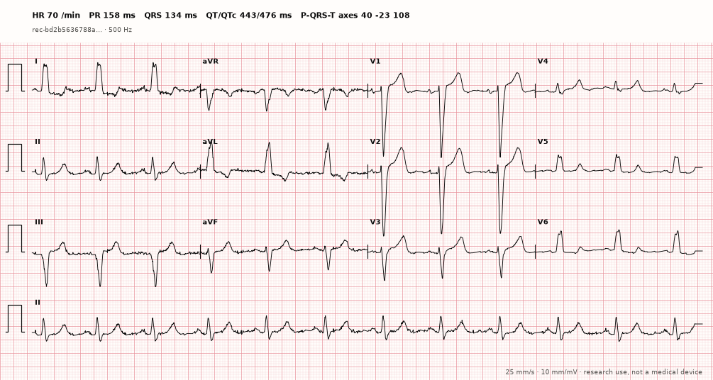

# ecg-records

**ecg-records** measures 12-lead (or 1–8-channel) ECG signals and emits a
small, versioned JSON document, the **ECG Record**. It contains record-level
intervals, axes and rhythm measures, median-beat values per lead, per-beat
fiducial points, intervals and amplitudes, signal quality and provenance in
raw-sample coordinates, with explicit units, an explicit reason for every
missing value, a stable address for every value and a per-field validation
status. It reads WFDB, EDF/BDF, CSV and NumPy files and draws clinical-format
plots. The Python import name is `ecgfeat`. Current release: **0.3.0**
(schema 1.1.0).

> This software is research and engineering software. It is not a medical
> device and is not intended to diagnose, treat, cure, or prevent disease.
> Outputs require independent validation for the intended use and must not be
> used as a substitute for professional medical judgment.

```bash
pip install "ecg-records[engine]"  # records + the compiled measurement engine
pip install ecg-records            # records only: read, query, plot (no measuring)
pip install "ecg-records[viz]"     # adds Matplotlib for ecgfeat.viz
pip install "ecg-records[all]"     # engine, plots, pandas tables, Plotly, ecginterpret
```

```python
import ecgfeat
from ecgfeat import viz

signal = ecgfeat.read_signal("ptbxl/records500/00000/00001_hr.hea")   # or ecgfeat.load_example("sinus")
record = ecgfeat.ecg_record(signal)
print(record.summary())                            # rate, P/PR/QRS/QT, QTc, axes
record.get("qt_interval_ms")                       # record level
record.get("median_st_60ms_uv", lead="V2")         # median beat of one lead
record.to_dataframe("leads")                       # pandas table, one row per lead
figure, ax = viz.plot_ecg(signal, record)          # 12-lead ECG paper, 25 mm/s, 10 mm/mV
open("ecg.record.json", "wb").write(ecgfeat.dumps_record(record))
```

```bash
ecg-record measure ptbxl/records500/00000/00001_hr.hea -o ecg.record.json
ecg-record batch 'ptbxl/records500/**/*.hea' --output-dir out --jobs 12 --table out/global.csv
```



Rule-based interpretation lives in the separate
[`ecginterpret`](https://pypi.org/project/ecginterpret/) distribution.

## Documentation

Online: **<https://humansys-lab.github.io/ecg-records/>**
(published from `main` by `.github/workflows/docs.yml`).

The sources live in [`docs/`](docs/index.md). Build locally with
`mkdocs build` (output in `build/site/`) or preview with `mkdocs serve`:

- [Installation](docs/getting-started/installation.md) and
  [Quickstart](docs/getting-started/quickstart.md)
- User guide: [input signals](docs/guide/input.md),
  [measuring](docs/guide/measuring.md),
  [the ECG Record format](docs/guide/record-format.md),
  [querying](docs/guide/querying.md),
  [saving and sidecars](docs/guide/serialization.md),
  [plotting](docs/guide/plotting.md),
  [command line](docs/guide/cli.md),
  [configuration](docs/guide/configuration.md),
  [errors](docs/guide/errors.md),
  [migration from the legacy API](docs/migration.md)
- [Validation](docs/validation.md),
  [performance](docs/performance.md),
  [limitations](docs/limitations.md),
  [compatibility](docs/compatibility.md), [FAQ](docs/faq.md)
- [API reference](docs/reference/api-ecgfeat.md),
  schema references [1.1](docs/reference/ecg-record-schema-1.1.md) and
  [1.0](docs/reference/ecg-record-schema-1.0.md)
- Developer guide: [architecture](docs/development/architecture.md),
  [contributing and testing](docs/development/contributing.md),
  [golden corpus](docs/development/golden-corpus.md),
  [validation policy](docs/development/validation-policy.md),
  [releasing](docs/development/releasing.md)

## This repository

This is the public home of the documentation, schemas and examples. The source
code of the measurement engine is not published (see *License* below).

| Path | Content |
|---|---|
| `docs/`, `mkdocs.yml` | the documentation site |
| `schemas/ecg-record/1.0/`, `1.1/` | JSON Schema, validation-evidence registry and legacy crosswalk per schema family |
| `examples/` | the reference signal and ECG Records that every documentation example runs on |
| `CHANGELOG.md` | changes per release of `ecg-records` |
| `tools/check_doc_examples.py` | runs every Python example of the site against the installed package |

Questions and bug reports: the [issue tracker](https://github.com/humansys-lab/ecg-records/issues).

## License

`ecg-records` (the ECG Record format, readers, queries, plots, CLI) is Apache
License 2.0. The compiled measurement engine, `ecg-records-engine`, is free for
noncommercial use under the PolyForm Noncommercial License 1.0.0 and needs a
commercial licence otherwise; see [Licensing](docs/licensing.md). Everything in
this repository (documentation, schemas, examples) is Apache-2.0; see
[LICENSE](LICENSE) and [NOTICE](NOTICE).
