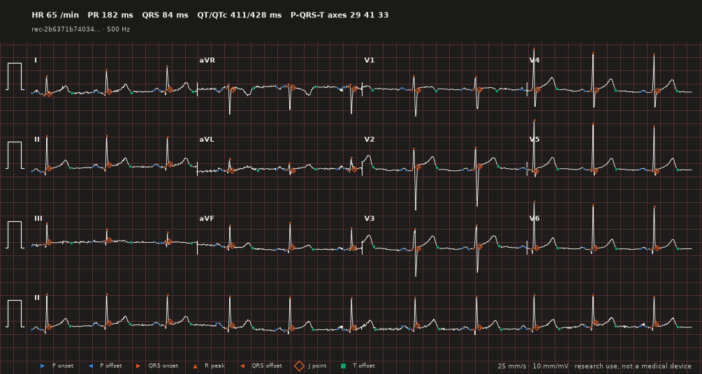
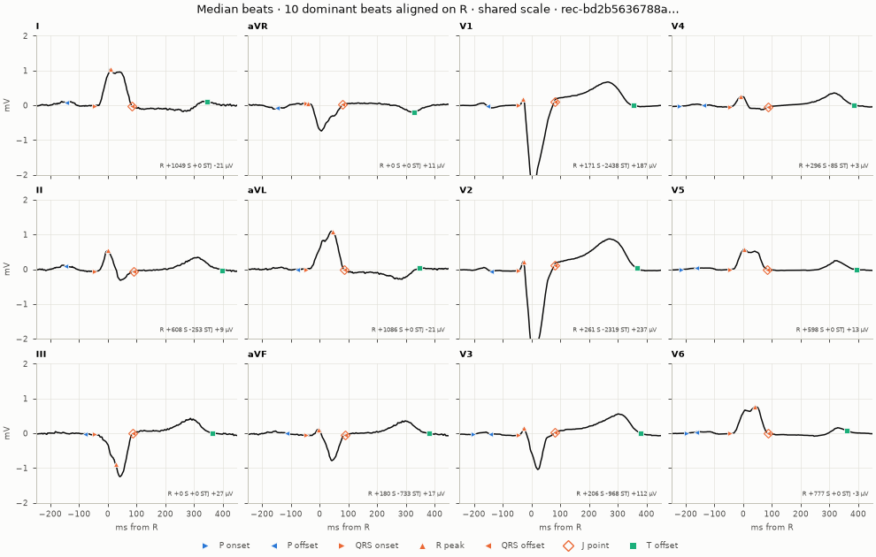
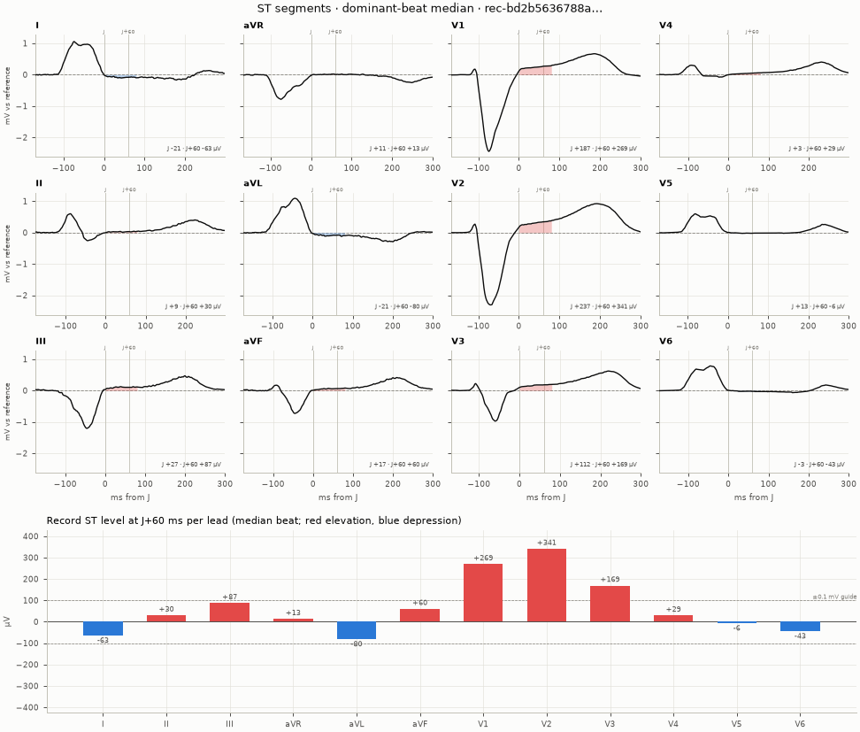
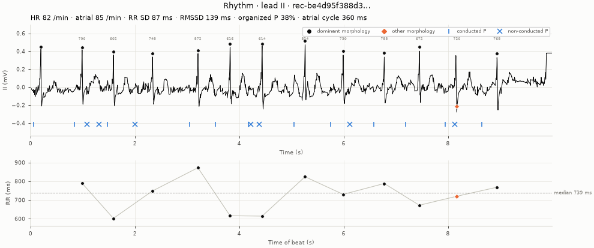
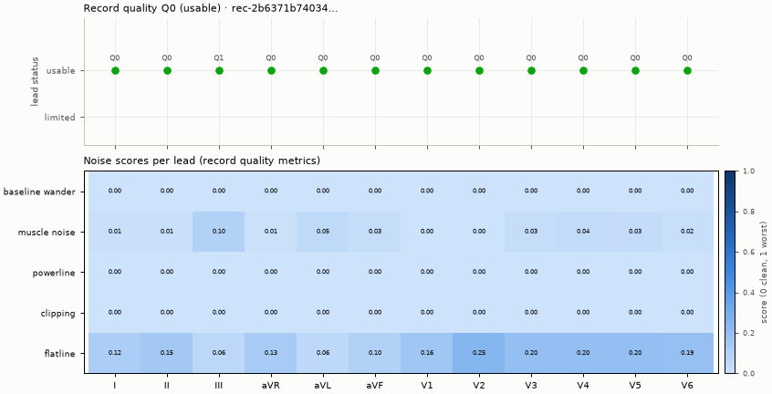

# Plotting

`ecgfeat.viz` draws a raw signal together with the record measured from it.
It needs the optional Matplotlib dependency:

```bash
pip install "ecg-records[viz]"
```

`import ecgfeat` and `import ecgfeat.viz` never import Matplotlib. The plotting
functions load on first use. Without Matplotlib, that first use raises
`ImportError` with the installation hint. `ecgfeat.viz` never uses `pyplot`:
it builds figures through the object-oriented API, so it works in scripts,
servers and notebooks without touching global figure state.

## ECG paper

`plot_ecg` draws the conventional 12-lead print: four time-aligned 2.5 s
columns (I–III, aVR–aVF, V1–V3, V4–V6) and a 10 s lead II rhythm strip, with 1
mV calibration pulses on a 1 mm / 5 mm grid. A new figure is sized in real
millimetres, so printing it at 100% gives 25 mm/s and 10 mm/mV. The header
prints the record-level measurements; `*` marks values the record kept but
flagged as not reportable.

```python
import matplotlib
matplotlib.use("Agg")

import ecgfeat
from ecgfeat.viz import plot_ecg

example = ecgfeat.load_example("lbbb")
paper_record = ecgfeat.ecg_record(example, profile="all")
fig, ax = plot_ecg(example, paper_record)      # layout="6x2" | "12x1", rhythm_leads=("II", "V1"), gain=5
fig.savefig("ecg.png", dpi=150)
```


`annotations="waves"` adds the landmarks, `style="dark"` the dark theme:



## Example

```python
import matplotlib
matplotlib.use("Agg")                       # headless backend for scripts; omit in notebooks

import numpy as np
from ecgfeat import ecg_record
from ecgfeat.viz import plot_beat, plot_record

signal = np.load("ecg.npy")
leads = ["I", "II", "III", "aVR", "aVL", "aVF", "V1", "V2", "V3", "V4", "V5", "V6"]
record = ecg_record(signal, sampling_rate=500, lead_names=leads, profile="all")

fig, axes = plot_record(signal, record, leads=["II", "V1", "V5"],
                        start_s=1.0, end_s=4.0, annotations="all")
fig.savefig("record.png", dpi=150)

fig, ax = plot_beat(signal, record, beat=3, lead="II")
fig.savefig("beat.png", dpi=150)
```

## Functions

| Function | Returns | Draws |
|---|---|---|
| `plot_record(signal, record, *, leads=None, start_s=None, end_s=None, annotations="waves", figure=None)` | `(Figure, tuple[Axes, ...])` | stacked leads over a time window |
| `plot_beat(signal, record, *, beat, lead, figure=None)` | `(Figure, Axes)` | one beat on one lead, with that cell's landmarks and PR/QRS/QT in the title |
| `plot_beat_all_leads(signal, record, *, beat, leads=None, figure=None)` | `(Figure, tuple[Axes, ...])` | one beat on every selected lead, in the standard 3 × 4 layout |
| `plot_representative_beat(signal, record, *, lead, figure=None)` | `(Figure, Axes)` | the median of all beats aligned on the record's R samples (−250 to +450 ms), with the median landmark offsets |
| `plot_quality_summary(signal, record, *, leads=None, figure=None, metrics="auto")` | `(Figure, tuple[Axes, ...])` | per-lead quality status and grade, and a heat map of the record's noise scores (`all` profile) or the signal RMS (`metrics="rms"`) |
| `plot_ecg(signal, record, *, layout="3x4", rhythm_leads=("II",), paper_speed=25, gain=10, annotations="none", ...)` | `(Figure, Axes)` | ECG paper at true scale (above) |
| `plot_median_beats(signal, record, *, leads=None, beats="dominant")` | `(Figure, tuple[Axes, ...])` | the dominant-beat median of every lead on one scale, landmark medians, and the record's median-beat R, S and ST-J amplitudes |
| `plot_st_segments(signal, record, *, leads=None, point="j60")` | `(Figure, (tuple[Axes, ...], Axes))` | per-lead medians aligned on J with the reference level and the ST deviation shaded, and the record's ST level per lead as bars |
| `plot_rhythm(signal, record, *, lead="II", start_s=None, end_s=None)` | `(Figure, (Axes, Axes))` | a lead strip with beat classes, RR intervals and atrial events (`all` profile), over the RR tachogram |
| `plot_record_interactive(signal, record, *, leads=None)` | Plotly `Figure` | stacked leads with hoverable landmarks (`interactive` extra) |

Every function also takes `style=` (below). `plot_record` takes
`y_scale="shared"` (default since 0.2: one millivolt span for all leads, each
centred on its median) or `"independent"`, and `plot_representative_beat`
takes `beats="dominant"` to leave ectopic beats out of the median.

Arguments:

- `leads`: lead names to draw, in the order given; default all record leads.
- `beat`: zero-based beat index into `record.axes["beats"]`.
- `start_s`, `end_s`: time window in seconds; default the whole recording.
- `annotations` (`plot_record` only): `"waves"` draws landmarks (default),
  `"beats"` marks R samples with beat indices, `"all"` does both, and `"none"`
  draws only the signal.

## What is drawn

Landmarks are the record's P onset and offset, QRS onset, R peak, QRS offset,
J point and T offset, each at its sample on the trace. Colour names the wave
(P blue, QRS orange, T aqua: the three categorical slots that stay
distinguishable side by side for normal and colour-deficient vision) and
marker shape names the landmark (▶ onset, ◀ offset, ▲ R peak, ◇ J point,
■ T offset). Markers shrink on long windows. Cells that the record
leaves absent are not drawn. **Nothing is measured while plotting**: every mark
comes from the record, so the plot shows exactly what the record claims.

The record can be a loaded `ECGRecord` (including sidecar-backed records) or
its JSON mapping. Use `ecgfeat.load_record(path)` for records with an NPZ
sidecar: a plain `json.load` mapping cannot resolve the sidecar.

## The signal must match the record

`signal` must be the exact array that produced the record: channel-major, one
row per record lead in `/acquisition/leads` order,
`/acquisition/sample_count` columns, and the same values and amplitude unit.
Before drawing anything, the functions compare the SHA-256 of
`np.ascontiguousarray(signal, dtype="<f8").tobytes()` with
`/artifacts/raw_signal/sha256`.

If they differ, or if a lead, beat, window or annotation selector names
something the record does not have, the call raises
`ecgfeat.viz.VisualizationInputError`. It subclasses
`ecgfeat.ECGInputError` (and `ValueError`) and has a machine-readable `code`:

```python
import numpy as np
from ecgfeat import load_record
from ecgfeat.viz import plot_record, VisualizationInputError

record = load_record("ecg.record.json")
signal = np.load("ecg.npy")
try:
    plot_record(signal * 2.0, record)            # not the measured signal
except VisualizationInputError as exc:
    print(exc.code)                              # signal_fingerprint_mismatch
```

## Embedding in your own figures

`figure=None` creates a new `Figure` with constrained layout. Pass an existing
`Figure` or `SubFigure` to have the function only add axes to it. The
suptitle and figure legend are added only to figures the function created.

```python
import matplotlib
matplotlib.use("Agg")

import numpy as np
from matplotlib.figure import Figure
from ecgfeat import load_record
from ecgfeat.viz import plot_beat, plot_quality_summary

record = load_record("ecg.record.json")
signal = np.load("ecg.npy")

figure = Figure(figsize=(12, 5), layout="constrained")
left, right = figure.subfigures(1, 2)
plot_beat(signal, record, beat=0, lead="II", figure=left)
plot_quality_summary(signal, record, figure=right)
figure.savefig("dashboard.png")
```

## More views









```python
from ecgfeat.viz import plot_median_beats, plot_rhythm, plot_st_segments

fig, axes = plot_median_beats(example, paper_record)
fig, (panels, bars) = plot_st_segments(example, paper_record)
fig, (strip, rr) = plot_rhythm(example, paper_record, lead="II")
```

## Styles and themes

```python
from ecgfeat import viz

with viz.use_style("dark"):                     # or viz.set_style("dark") for the session
    fig, ax = viz.plot_ecg(example, paper_record)
custom = viz.PlotStyle().replace(ink="#203040", paper_major="#d08080", marker_size=5)
fig, axes = viz.plot_record(example, paper_record, leads=["II"], style=custom)
```

## Web front-ends

`viz.annotations_to_dict(record)` needs neither Matplotlib nor the signal: it
returns JSON-ready beats, landmarks (samples and seconds), atrial events and
record-level values for a browser chart. `viz.plot_record_interactive(signal,
record)` builds a Plotly figure with hover read-outs.

```python
data = viz.annotations_to_dict(paper_record, leads=["II"])
print(len(data["beats"]), list(data["landmarks"]["II"]))
```

## Restyling

Every artist the package adds carries a `gid` starting with `ecgfeat.viz:`
(for example `ecgfeat.viz:fiducial:r_peak`), so you can find and restyle it:

```python
import matplotlib
matplotlib.use("Agg")

import numpy as np
from ecgfeat import load_record
from ecgfeat.viz import plot_beat

record = load_record("ecg.record.json")
signal = np.load("ecg.npy")
fig, ax = plot_beat(signal, record, beat=0, lead="II")
for artist in ax.get_children():
    gid = artist.get_gid() or ""
    if gid.startswith("ecgfeat.viz:fiducial:"):
        artist.set_alpha(0.5)
```

## Legacy plotting helpers

The pre-record helpers that plot legacy `ECGFeatures` objects (`plot_beat`,
`plot_rep_beat`, `plot_beat_all_leads`, `plot_quality_summary`) live unchanged
in `ecgfeat.viz.legacy`. The old import path `ecgfeat.visualize` and the
top-level `ecgfeat.plot_*` functions still work, but warn: they are removed no
earlier than 0.3.0. They use `pyplot` and are imported only when requested.
New code should use the `(signal, record)` functions above.
